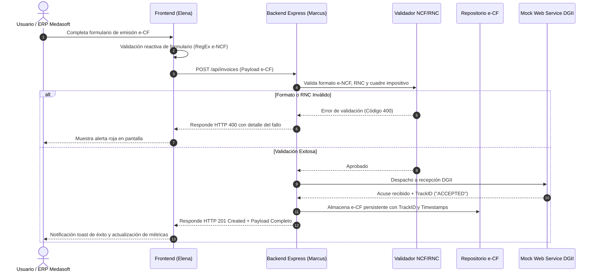

# Medasoft e-CF Hub - Especificaciones de Requerimientos del Sistema (SRS)

**Autor:** Sofia (Product Analyst & Requirements Lead)  
**Proyecto:** Medasoft e-CF Hub (Sistema Integral de Facturación Electrónica DGII)  
**Marco Regulatorio:** Ley 32-23 de Facturación Electrónica en la República Dominicana & Normas DGII (06-2018, 01-2020)  
**Versión:** 1.0.0-PROD  
**Estado:** Aprobado / Firmado  

---

## 1. Visión y Propósito del Producto

El **Medasoft e-CF Hub** es una plataforma corporativa full-stack diseñada para centralizar, validar, emitir y consultar Comprobantes Fiscales Electrónicos (e-CF) bajo los estándares estrictos de la Dirección General de Impuestos Internos (DGII) de la República Dominicana.

La solución proporciona un motor de validación en tiempo real de secuencias e-NCF, cálculo fiscal automatizado (subtotal, descuentos, ITBIS 18% y retenciones), almacenamiento auditable y una interfaz ejecutiva moderna para monitoreo y gestión operativa.

---

## 2. Definición de Tipos de e-NCF (Estándar DGII)

La plataforma soporta la validación y emisión de los comprobantes electrónicos oficiales según la DGII:

| Código e-NCF | Nombre Oficial DGII | Longitud | Prefijo | Uso Principal |
| :--- | :--- | :--- | :--- | :--- |
| **E31** | Factura de Crédito Fiscal Electrónica | 13 caracteres | `E31` | Operaciones comerciales con derecho a deducción de ITBIS y costo. |
| **E32** | Factura de Consumo Electrónica | 13 caracteres | `E32` | Operaciones con consumidores finales (sin valor de crédito fiscal). |
| **E33** | Nota de Débito Electrónica | 13 caracteres | `E33` | Recuperación de costos, recargos o ajuste de montos a favor del emisor. |
| **E34** | Nota de Crédito Electrónica | 13 caracteres | `E34` | Devoluciones de mercancías, anulación o reducción de montos facturados. |
| **E41** | Comprobante Electrónico de Compras | 13 caracteres | `E41` | Adquisición de bienes/servicios a personas no registradas en DGII. |
| **E44** | Comprobante para Pagos al Exterior | 13 caracteres | `E44` | Pagos de rentas gravadas de fuente dominicana a no residentes. |

---

## 3. Requerimientos Funcionales (RF)

- **RF-01 (Validación Estricta de e-NCF):**  
  Todo número de comprobante fiscal debe cumplir con el formato regex `^E(31|32|33|34|41|44)\d{10}$` (exactamente 13 caracteres alfanuméricos, iniciando con `E` seguido del código de comprobante y 10 dígitos numéricos correlativos).

- **RF-02 (Validación de Identificación Fiscal RNC / Cédula):**  
  El RNC del emisor y receptor debe ser de 9 dígitos (empresas) o 11 dígitos (cédula de identidad física). Se implementa validación con algoritmo Módulo 10/11.

- **RF-03 (Motor de Cálculo Impositivo ITBIS):**  
  El sistema calcula dinámicamente:
  $$\text{Subtotal} = \sum (\text{cantidad} \times \text{precio\_unitario})$$
  $$\text{ITBIS (18\%)} = \text{Subtotal Gravado} \times 0.18$$
  $$\text{Total e-CF} = \text{Subtotal} + \text{ITBIS} - \text{Descuentos}$$

- **RF-04 (Emisión Asíncrona & Generación de TrackID):**  
  Al emitir un e-CF válido, el sistema genera de forma determinística un `TrackID` único (UUIDv4 formateado) que simula el acuse de recibo del Web Service de la DGII.

- **RF-05 (Consulta y Trazabilidad de Estado DGII):**  
  Permite consultar en tiempo real el ciclo de vida del comprobante: `PENDING`, `ACCEPTED`, `ACCEPTED_WITH_OBSERVATIONS` o `REJECTED`.

- **RF-06 (Dashboard Analítico Ejecutivo):**  
  Presentación interactiva de métricas clave (Total Facturado, ITBIS Acumulado, Cantidad de e-CF Emitidos, Distribución por Tipo de Comprobante).

- **RF-07 (Exportación de Reporte Fiscal Formato 607 DGII):**  
  Generación dinámica y descarga en formato CSV UTF-8 con BOM de las transacciones emitidas, conteniendo RNC/Cédula del comprador, tipo de comprobante, e-NCF, montos facturados, ITBIS 18% y TrackID de certificación. Implementado por Elena.

---

## 4. Historias de Usuario & Criterios de Aceptación (Gherkin)

### Historia 1: Emisión exitosa de Factura de Crédito Fiscal (E31)
>
> **Como** Operador de Facturación de Medasoft,  
> **Quiero** registrar una factura con e-NCF tipo E31, ítems gravados y RNC válido,  
> **Para** remitir el comprobante a la DGII y obtener el TrackID oficial de aceptación.

```gherkin
Scenario: Emisión exitosa de e-CF E31 con ITBIS
  Given que el emisor tiene RNC registrado "131456789" con estado ACTIVO en DGII
  And el cliente receptor tiene RNC válido "101987654"
  When el usuario envía una factura con e-NCF "E310000000001" con 2 licencias de software a RD$ 15,000.00 c/u
  Then el backend calcula un Subtotal de RD$ 30,000.00
  And calcula un ITBIS (18%) de RD$ 5,400.00
  And calcula un Total Facturado de RD$ 35,400.00
  And responde con HTTP status 201 Created
  And retorna un TrackID de 36 caracteres y estado "ACCEPTED"
```

### Historia 2: Rechazo automático de e-NCF con formato inválido
>
> **Como** Auditor de Calidad del Sistema,  
> **Quiero** que el sistema bloquee comprobantes que no cumplan la estructura DGII,  
> **Para** evitar penalidades y rechazos en el receptor de la DGII.

```gherkin
Scenario: Rechazo de e-NCF con estructura o longitud incorrecta
  Given que se intenta emitir un comprobante con número "B0100000001" (formato NCF tradicional pre-eCF)
  When el servicio de validación procesa el payload
  Then el sistema rechaza la transacción con código HTTP 400 Bad Request
  And devuelve el mensaje de error: "Formato de e-NCF inválido. Debe iniciar con E seguido del tipo oficial (31, 32, 33, 34, 41, 44) y 10 dígitos numéricos."
```

---

## 5. Arquitectura del Flujo de Datos



---

## 6. Criterios de Aceptación Globales (DoD - Definition of Done)

1. **Backend:** 100% de los endpoints REST responden con esquema JSON estandarizado y códigos de estado HTTP correctos (200, 201, 400, 404, 500).
2. **Frontend:** Interfaz responsiva moderna (Tailwind CSS) con actualización reactiva sin refrescar la página.
3. **Automatización:** Suite de pruebas de integración desarrollada por Vector que cubra casos de éxito, validación y excepciones con tasa de pase del 100%.
4. **Auditoría:** Matriz de casos extremos auditada y aprobada por Echo en `docs/QA_AUDIT_REPORT.md`.

*Documento firmado electrónicamente por Sofia - Requirements Lead (Medasoft AI Team).*
